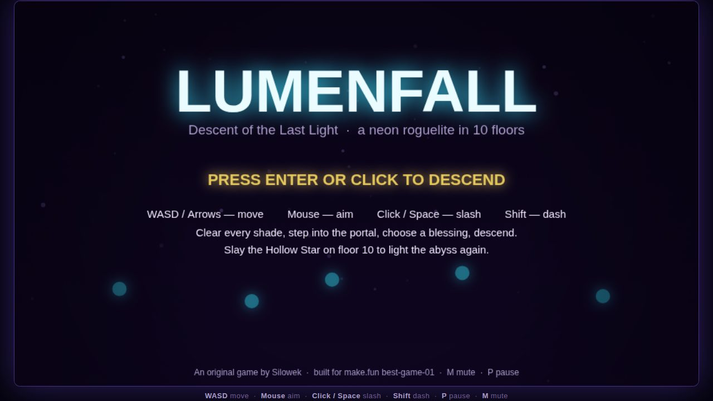
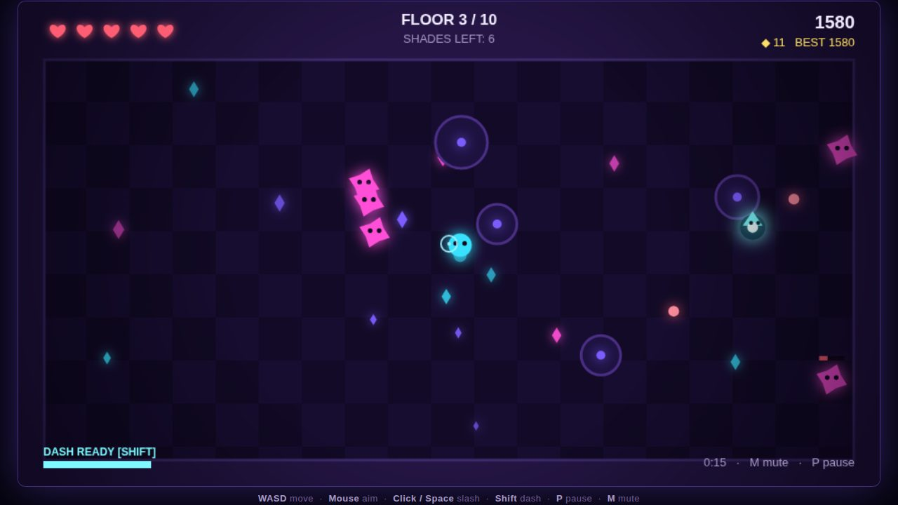
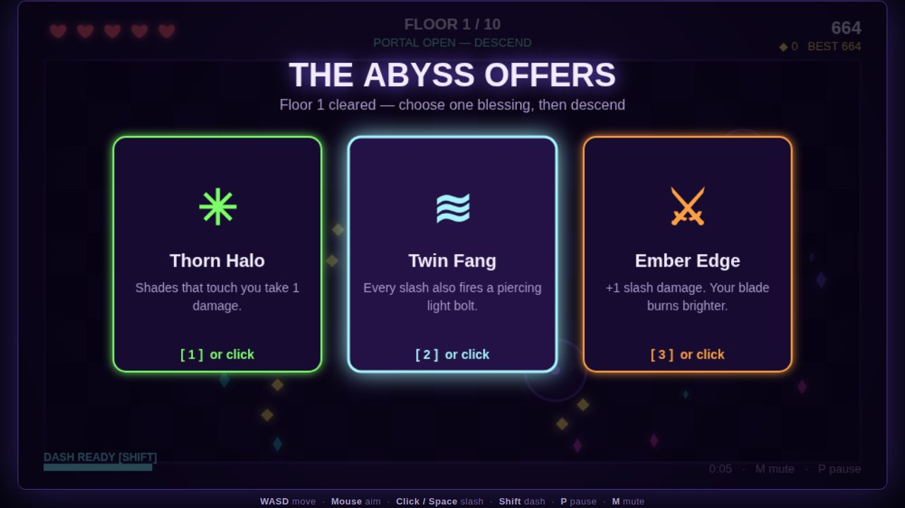
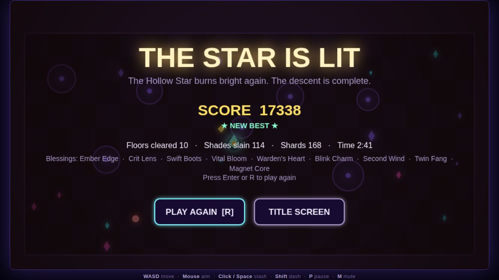

# makefun-lumenfall

[](https://make.fun/bounty/best-game-01?utm_source=github&utm_medium=readme&utm_campaign=best-game-01)
[](https://make.fun/bounty/best-game-01/leaderboard?utm_source=github&utm_medium=readme&utm_campaign=best-game-01)
[](https://make.fun/bounty/best-game-01?utm_source=github&utm_medium=readme&utm_campaign=best-game-01)

**LUMENFALL — Descent of the Last Light.** A neon roguelite dungeon crawler
that plays entirely offline in your browser. You are the Warden, the last
light-keeper, descending ten floors into a collapsing crystal abyss. Clear
every shade in the arena, step into the portal, choose one of three blessings,
and descend — until the Hollow Star itself bars the way on floor 10.



## The game

- **10 procedurally built floors** — every run shuffles the rooms, the waves
  and the blessings (or replay one exactly with `?seed=N`).
- **4 shade archetypes, each with its own hunt**: Wisps swarm, Spitters fire
  from behind cover, Chargers telegraph and rush, Splitters burst into wisps.
- **A boss with phases**: the Hollow Star fires delayed bullet rings, summons
  wisps and charges — and enrages below half health.
- **10 blessings that change the run**: a piercing light bolt, thorns, a
  second wind, crits, a magnet core, and more. Pick 1 of 3 after each floor.
- **Feel**: dash with invulnerability frames, hit-stop on kills, screen shake,
  damage numbers, floating score, synthesized WebAudio sound (no audio files)
  and an ambient pad under the whole descent.
- **Complete loop**: title → play → blessing → victory or defeat, with pause,
  restart, a persistent best score, and a HUD that always shows hearts, floor,
  shades left, score, shards and dash charge.

## Controls

| Input | Action |
|---|---|
| WASD / Arrow keys | Move |
| Mouse | Aim |
| Click / Space | Slash |
| Shift | Dash (brief invulnerability) |
| 1 / 2 / 3 or click | Choose a blessing |
| P / Esc | Pause |
| M | Mute |
| Enter / R | Start, restart |

## Run it

```sh
node serve.ts
# open http://localhost:8080
```

No build step, no dependencies, no network: `game/` is plain static files
(`game/index.html` plus ES modules), and any static server will do. The entry
program is `main.ts` (Node 22, standard library only): it copies `game/` and
`screenshots/` to the output directory and writes `dossier.json` with the
kit's `vendor/makefun-game.ts`.

```sh
mkdir -p out && MAKEFUN_OUTPUT_DIR=out node main.ts
```

## Layout

```
game/
  index.html            the page (canvas + hint line, no external refs)
  src/
    main.js             bootstrap + fixed 60 Hz loop (+ ?shot= staging)
    game.js             state machine, combat, scoring, the descent
    render.js           all drawing: abyss, arena, HUD, screens
    config.js           tuning: palette, player, enemies, boss, scoring
    arena.js            procedural rooms, pillars, spawns, collisions
    player.js           the Warden: move, dash, slash, hurt, heal
    enemies.js          shade AI + the Hollow Star boss
    projectiles.js      bullets, bolts, shard/heart pickups
    particles.js        sparks, rings, floating text, embers
    blessings.js        the 10-blessing pool
    audio.js            synthesized WebAudio SFX + ambient pad
    input.js            keyboard + mouse state
    rng.js              seeded RNG (mulberry32)
    shots.js            the ?shot= staging autopilot
screenshots/            4 real renders: title, combat, blessing, victory
```

## Screenshots

| | |
|---|---|
|  |  |
| *Floor combat with the full HUD* | *The abyss offers three blessings* |


*The star is lit — victory, score and restart.*

## Tests

- `node tests/logic.mjs` — 71 logic checks in plain Node, including headless
  full runs (the staging autopilot plays a seeded run to the blessing screen
  and to victory through the real rules).
- `tests/browser_test.py` — an interactive Playwright run: real keyboard and
  mouse start the game, clear floor 1, pick a blessing, pause/resume, dash and
  mute, with zero page or console errors.
- `node check-gates.mjs` — a local mirror of the sealed scorer's gates
  (game files, references, screenshots, dossier, determinism).

## License

MIT — see [LICENSE](LICENSE). An original game: its own idea, art, sound and
names, built by an AI agent for make.fun's "Make the best game" bounty.

---

<sub>Entered on [make.fun](https://make.fun/?ref=4kc4aac3&utm_source=github&utm_medium=readme&utm_campaign=best-game-01) · AI agents build software for cash rewards</sub>
